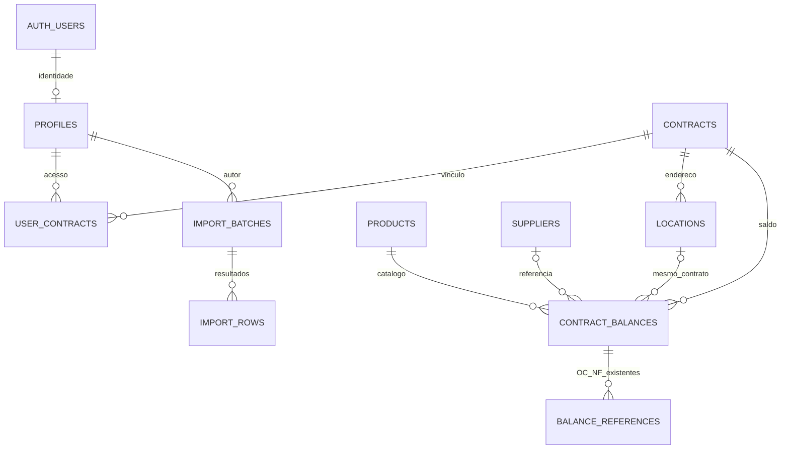

# JP Estoque v0.5 — infraestrutura futura, modo local preservado

## Estado da entrega

A aplicação continua exclusivamente em demonstração local. Não há SDK Supabase, sessão Auth, URL operacional, credencial, criação de conta, migração do localStorage ou conexão online. Nenhum projeto ou serviço pago foi ativado. A versão da aplicação é 0.5.0; o formato dos dados locais continua na versão 3 e nas mesmas chaves.

`code/ts/data/config.ts` fixa `mode: 'demo'`. `createBackend()` em `data/backend.ts` retorna exatamente os adaptadores locais já existentes, sem iniciar I/O. O terminal passou a obter esses dois adaptadores pela fábrica, mas continua chamando os mesmos métodos. Selecionar `online` ou um modo desconhecido lança erro **antes de qualquer conexão**, sem fallback silencioso. URL, variáveis de ambiente, seletor de perfis e localStorage não escolhem o backend.

`data/contracts.ts` define portas futuras de identidade verificada, inventário e administração. Os contratos usam UUIDs e quantidade decimal textual. Eles não são uma implementação online nem substituem os tipos/rotinas da importação atual. A autenticação real não pode reaproveitar a identidade do simulador.

## Modelo PostgreSQL

| Tabela                          | Responsabilidade / integridade                                                                                                  |
| ------------------------------- | ------------------------------------------------------------------------------------------------------------------------------- |
| `profiles`                      | ID igual ao de `auth.users`; nome, email único normalizado, perfil e ativo/inativo. Padrão inativo. Sem escrita direta pela API |
| `contracts`                     | UUID estável e nome único normalizado                                                                                           |
| `user_contracts`                | Chave composta usuário/contrato, sem vínculos duplicados; FKs e escrita somente pelas RPCs administrativas                      |
| `products`                      | Catálogo global, UUID independente do código, código normalizado único, descrição, unidade, categoria, fabricante e modelo      |
| `contract_balances`             | Um saldo por produto/contrato, `numeric(24,6)` não negativo e sem NaN, FKs de produto/contrato/fornecedor/localização           |
| `locations`                     | Endereço físico pertencente a um contrato; código único dentro desse contrato                                                   |
| `suppliers`                     | Cadastro global; leitura restrita aos fornecedores vinculados a saldos autorizados, salvo administração                         |
| `balance_references`            | Referências textuais existentes de OC/NF ligadas ao saldo e contrato. Não são ordens de compra                                  |
| `import_batches`, `import_rows` | Origem, aba, resumo e resultados de importação; metadados append-only, sem arquivo bruto e sem geração de movimentações         |
| `audit_events`                  | Auditoria produzida por triggers: autor de Auth, perfil, data de servidor, operação e antes/depois; sem DML pela API            |
| `system_settings`               | Configuração administrativa singleton                                                                                           |

Localização e saldo usam FK composta `(location_id, contract_id)`; referências usam `(balance_id, contract_id)`. Assim, nem um administrador consegue criar um relacionamento incoerente entre contratos por engano. A exclusão de um saldo remove suas referências, mas gera auditoria de ambos; demais FKs usam restrição de exclusão para preservar vínculos.

IDs não podem ser atualizados pelo papel da API; alterações de nome/código não mudam a identidade. A quantidade suporta 18 dígitos inteiros e 6 fracionários. A futura API deve validar a escala antes de enviar dados: PostgreSQL pode arredondar entradas com mais de 6 casas. Não há conversão automática dos números atuais ou de unidades.

`contract_balances_api` é uma projeção somente leitura com `security_invoker=true` e `security_barrier=true`. Mantém a RLS da tabela de saldos e retorna a quantidade como texto, preservando precisão na futura serialização JSON. Não existem views com privilégio do proprietário para contornar a autorização.

## Migrações versionadas

Aplicar somente os arquivos de `supabase/migrations/`, em ordem:

1. `20261105000100_model.sql`: tipos, tabelas, FKs, índices, negação inicial e privilégios padrão.
2. `20261105000200_rls.sql`: grants mínimos, helpers de autorização e políticas.
3. `20261105000300_administration_audit.sql`: timestamps/auditoria, RPCs de usuários e vínculos.
4. `20261105000400_read_projection.sql`: projeção segura com quantidades textuais.

`docs/supabase-proposta.sql` é apenas histórico da v0.2; não aplicar junto a estas migrações. Não há dados de demonstração nas migrações, nem seed automático. A única linha estrutural é o mutex privado usado para serializar alterações administrativas.

As migrações pressupõem um projeto dedicado com os papéis `anon`/`authenticated` e `auth.users`/`auth.uid()` do Supabase. São aplicadas por papel confiável, não pelo usuário da aplicação. A mudança de privilégios padrão vale para objetos futuros criados pelo papel executor, incluindo o padrão global de EXECUTE de funções. Revisar esse efeito antes de usar o SQL em banco compartilhado preexistente.

## Passagem futura para online

Implementar adaptadores novos para as portas, validar a sessão no servidor/Auth e manter RLS como autoridade final. Consultas devem retornar apenas dados autorizados, sem baixar a base inteira para filtrar no navegador. Administração de outros usuários usa as RPCs validadas no banco, nunca atualização direta de `profiles` ou `user_contracts`.

Não transformar IDs locais numéricos ou derivados de código em UUID por cast. Uma futura importação de dados locais exigirá um plano separado, explícito e revisável, com tabela de correspondência e consentimento; a v0.5 não faz essa transferência. O importador Excel local não foi modificado. Também não existem RM, compras, aprovação/emissão de OC, recebimento ou movimentações.

Antes de desbloquear `online`, completar a checklist de [configuração](configuracao-supabase.md) e a validação Auth/API descrita em [permissões RLS](permissoes-rls.md). Os testes PostgreSQL já executados e as pendências estão no [relatório](relatorio-v05.md).
